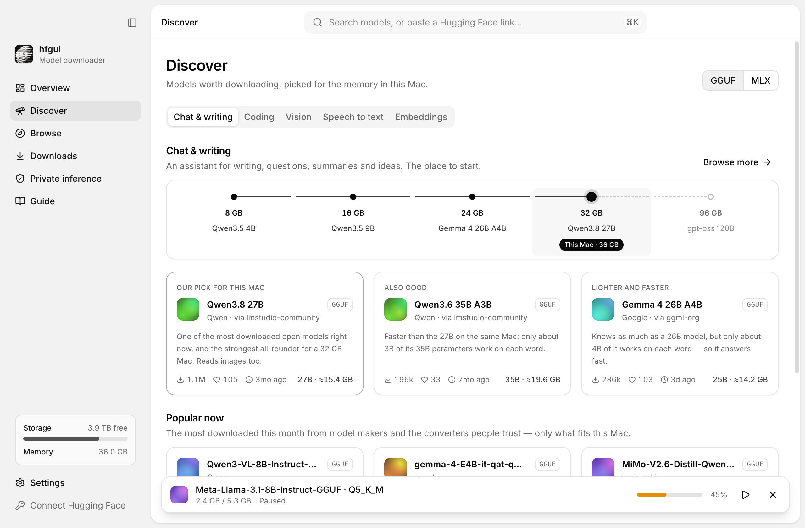

<p align="center">
  
</p>

<h1 align="center">hfgui</h1>

<p align="center">
  Find and download open models from Hugging Face on your Mac.<br>
  It picks the size that fits your memory, keeps big downloads going until they're done,<br>
  and puts models where your apps look for them.
</p>

<p align="center">
  <a href="https://github.com/jakubsejkora/hfgui/releases/latest"><b>Download for macOS</b></a>
  &nbsp;·&nbsp; Apple silicon, macOS 12 or later &nbsp;·&nbsp; Free and open source
</p>



## What it does

- **Know what to download.** Discover recommends models for chat, coding, vision, speech and
  embeddings, picked for the memory in your Mac — and shows how the pick changes on a Mac
  with more. Next to the picks: what's popular right now, from model makers and the
  converters people trust, without the remixes that crowd the Hub's trending lists.
- **Browse the Hub.** Search, or sort by trending, downloads and likes. Filter by format
  (GGUF, MLX) and task. Cards show the size you would actually download, not the size of
  the biggest file in the repo.
- **Know what fits.** Every quantization says whether it fits this Mac's memory. Drag a
  model onto a destination and hfgui picks the best one for you.
- **Paste a link.** Any `huggingface.co/…` link, or a bare `org/model`, in the search field
  opens that model. You can also drop a link from your browser onto the window.
- **Downloads that finish.** Parallel downloads, pause and resume — even after quitting —
  sha256 checks, a disk-space check before starting, and a speed limit so calls keep
  working.
- **Models where your apps look.** Your own models folder (`~/Models` by default), or
  straight into **LM Studio** and **exo** if they're installed. Apps you don't have are
  never mentioned.
- **Model updates.** hfgui notices when a model you downloaded changes on the Hub,
  downloads only the files that changed, and lets you keep the old version or replace it.
- **No dead disk space.** Cancelling deletes what a download wrote, and leftovers from
  abandoned downloads are cleaned up in one click. hfgui only ever deletes files it wrote
  itself.
- **Gated models.** Add a Hugging Face token once. It's stored encrypted and only ever sent
  to huggingface.co.
- **A Guide** for people new to local models: GGUF or MLX, which size fits, where files
  go, and how to run a model with LM Studio, Ollama, llama.cpp, mlx-lm or exo.


Every feature in detail: [docs/FEATURES.md](docs/FEATURES.md).

## Install

1. Download `hfgui-<version>-arm64.dmg` from the
   [latest release](https://github.com/jakubsejkora/hfgui/releases/latest).
2. Open it and drag **hfgui** to **Applications**.

hfgui is signed and notarized by Apple: the first time, macOS just confirms you want to
open an app from the internet. It needs a Mac with Apple silicon (M1 or later) and macOS 12
Monterey or later.

## Updates

hfgui updates itself from this repository's
[releases](https://github.com/jakubsejkora/hfgui/releases). It checks at launch and every
few hours, downloads a new version in the background, and installs it the next time you
quit. To install it right away, click **Restart to update** in the sidebar. Downloads in
progress pause for the restart and pick up where they left off.

There's no update server: the app reads the latest release on GitHub. Each update is
checked against its sha512, and macOS installs it only if it's signed by the same
developer as the copy you're running. You can turn automatic checks off in Settings →
About.

## Privacy

- No account, no telemetry, no analytics, no crash reporting.
- Over the internet, hfgui connects only to **Hugging Face** (search, model information,
  downloads) and **GitHub** (update checks and updates). If you use exo, it also tells
  exo's local API, on this Mac, about the models you add.
- Your Hugging Face token is encrypted with macOS's keychain-backed storage, and never
  leaves the background process except on its way to huggingface.co. If you've signed in
  with the Hugging Face CLI, hfgui can use that token instead.
- When hfgui comes to the front, it looks at the clipboard for a Hugging Face link, in the
  background process. Only a model name ever reaches the window. You can turn this off in
  Settings.
- **Report a bug** (Settings → About) opens a pre-filled issue in your browser. Nothing is
  sent until you submit it.
- The only numbers the developer sees are GitHub's public download counters for release
  files: how often the installer, the updates and the update check were downloaded.
  Downloads, not people.

## Build from source

You need Node.js 22 or newer.

```sh
npm install
npm run dev        # run with hot reload
npm test           # unit tests
npm run dist:mac   # a local build in dist/ (signed if you have a Developer ID)
```

[CONTRIBUTING.md](CONTRIBUTING.md) covers the code layout, the end-to-end tests and the
conventions. [docs/RELEASING.md](docs/RELEASING.md) covers how releases are signed,
notarized and published.

## Contributing

Bug reports and pull requests are welcome — and so are model suggestions: Discover's picks
live in [`src/shared/picks.ts`](src/shared/picks.ts). See [CONTRIBUTING.md](CONTRIBUTING.md), and
[SECURITY.md](SECURITY.md) for reporting vulnerabilities privately.

## License

[MIT](LICENSE) © 2026 Jakub Sejkora

hfgui is an independent project. It is not affiliated with or endorsed by Hugging Face,
LM Studio or exo. Their names are trademarks of their respective owners.
