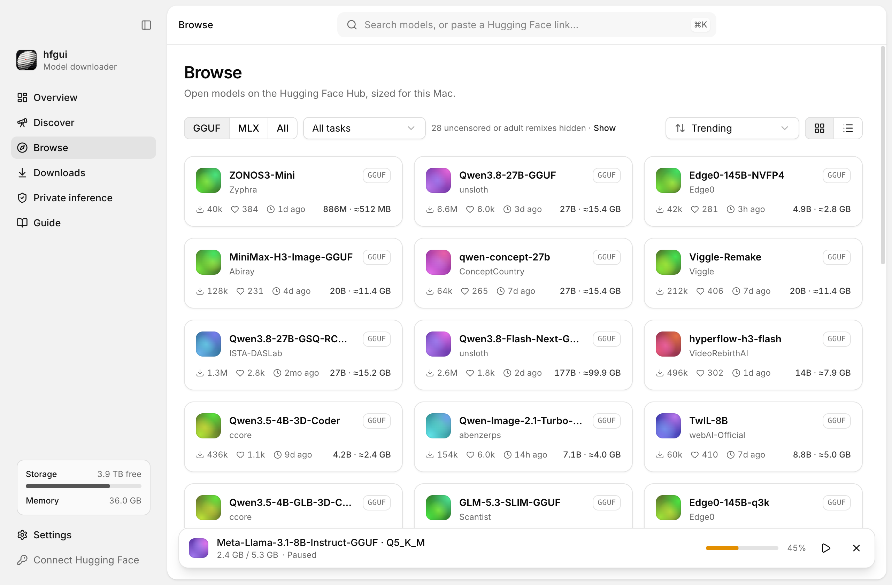
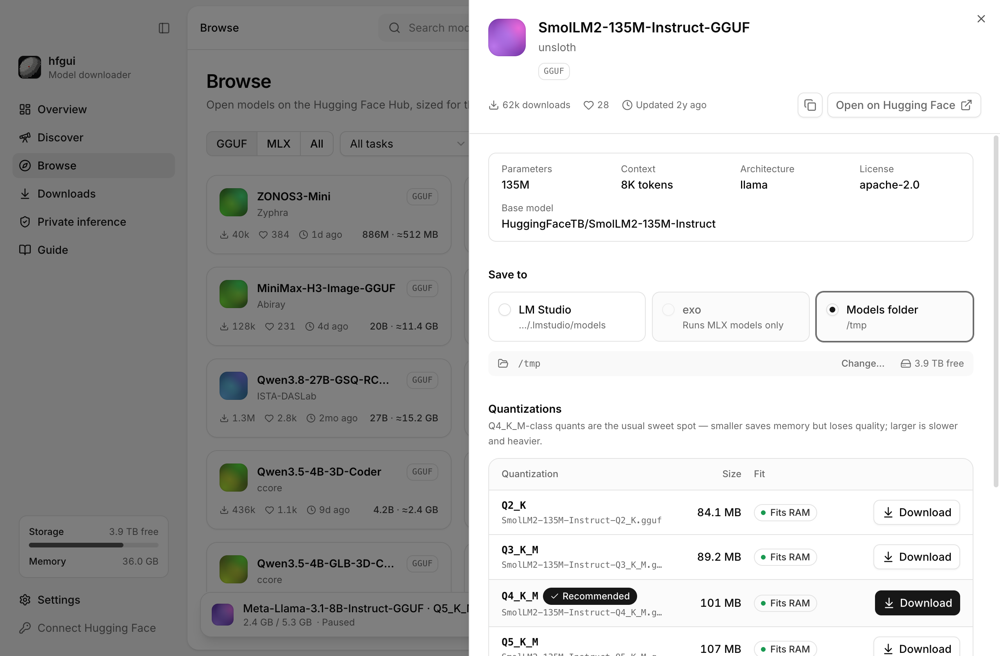
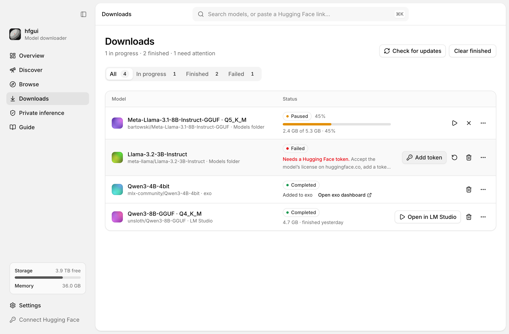
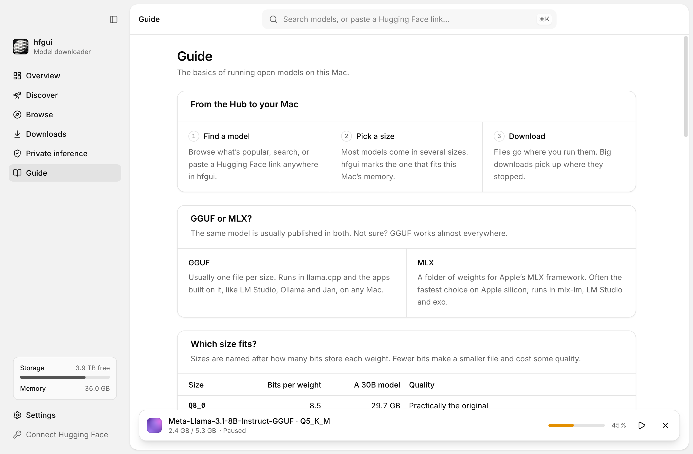
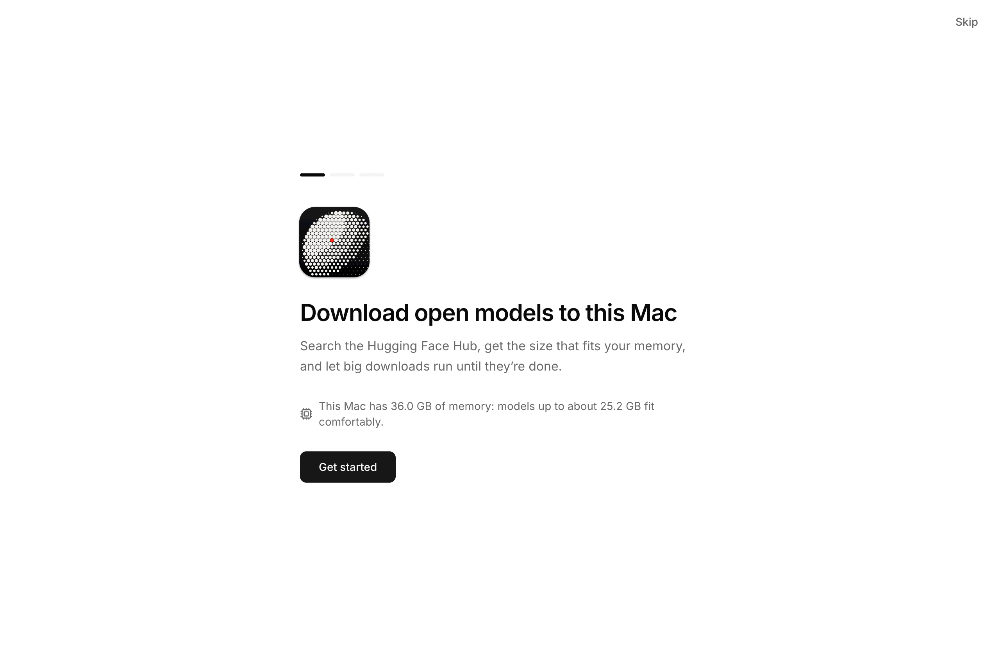

# hfgui in detail

The long version of the [README](../README.md): every feature, and the thinking behind the
design.

## Everything it does

- **Welcome**: on first launch, choose where models go and, optionally, add a Hugging Face
  token. LM Studio and exo are offered only when they're on this Mac; nothing asks you to
  install anything. Settings → About → Show again replays it.
- **Overview** at a glance: what is downloading, what landed, free space where models go,
  how big a model this Mac can run, a way into the Guide, and our recommended model in each
  category for this Mac's memory.
- **Discover**: what to download for chat & writing, coding, vision, speech to text and
  embeddings. Each category has hand-picked models for every Mac memory size
  (`src/shared/picks.ts`, checked against the Hub in tests); a memory ladder shows which
  one this Mac gets and how the pick changes on a Mac with more. GGUF or MLX with one
  switch. Below the picks, **Popular now**: the Hub's most downloaded in the category,
  kept to model makers and trusted converters, without uncensored or adult remixes, one
  entry per underlying model, and only what fits this Mac's memory.
- **Private inference**: models for jobs that should never leave the Mac — private
  dictation, meeting notes, comparing models side by side.
- **Guide**: the basics for people new to local models — GGUF or MLX, which size fits (with
  this Mac's own memory figures), where files go, running a model with LM Studio, Ollama,
  llama.cpp, mlx-lm or exo, models that ask for a license, and disk space.
- **Browse** the Hugging Face Hub: search, sort by Trending / Most downloaded / Most liked /
  Recently updated, filter by format (GGUF / MLX) and task — as cards or as a dense table.
  Cards show parameters and the size you would actually download (the estimated Q4_K_M
  file for GGUF repos), plus "In library" once a model is downloaded. Right-click any model
  for "Download best fit to…" — the keyboard-reachable twin of drag-and-drop. Uncensored
  and adult remixes, which fill a third of the Hub's trending GGUF list, stay out of the
  listing ("28 hidden · Show"); a search for them still finds them.
- **Paste a link.** The search field doubles as an omnibox: paste any
  `huggingface.co/org/model` URL (or type a bare `org/model`) and it resolves straight to
  the model instead of keyword-searching. `/tree/`, `/blob/` and `/resolve/` links work too.
  You can also **drag a link from your browser onto the window**, and when hfgui regains
  focus with a Hub link on the clipboard it offers to open it — the clipboard is read and
  parsed in the main process, so nothing but a model name ever reaches the UI.
- **Model detail**: GGUF quantizations grouped (multi-part files collapsed), file sizes,
  a "fits your RAM" hint per quant, full file list for MLX repos.
- **Download engine**: parallel jobs, pause / resume / cancel, resumable across app restarts
  (HTTP Range + `.partial` files, atomic rename on completion), disk-space pre-flight,
  speed / ETA, gated-model token support (stored encrypted via `safeStorage`).
- **Speed limit**: cap the combined speed of all downloads so calls and browsing keep working.
  One click from the speed readout in the top bar, or in Settings; applies instantly to
  downloads already running. It throttles the connection itself — held-back chunks
  back-pressure the socket, so TCP slows the sender — not just the disk writes. Switched on
  mid-download with a cap that wouldn't bite, it picks one under half the current speed instead.
- **Downloads dock**: live progress from any view, with pause and cancel in reach. The
  Downloads page keeps the history (In progress / Finished / Failed), Finder access, exo
  registration status, and plain-language help when something fails. Cancelling asks first,
  because it deletes what was downloaded so far.
- **No dead disk space**: cancelling deletes everything an unfinished download wrote
  (including the files a multi-file model had already finished); failed downloads can be
  discarded; finished models can be deleted from disk while other quantizations in the same
  folder stay; and data left by downloads removed from the list before they finished is
  found and cleaned up in one click. hfgui keeps a ledger of the files it writes, so it only
  ever deletes its own — never another app's, even though exo's downloader writes `.partial`
  files into the same folder. Finished models whose files were moved or deleted are flagged
  with **Download again**.
- **Model updates**: hfgui checks finished downloads against the Hub (shortly after launch,
  twice a day, or Downloads → Check for updates) and says what changed — "chat template and
  tokenizer · 17 KB to download". **Update** asks whether to replace the current version or
  keep both, and downloads only the changed files; unchanged weights are shared with the old
  version as hard links, so they take no extra space (small files such as configs are copied,
  so editing one version's never changes the other's). The new version moves into the model's
  folder (file by file, so other GGUF sizes in it are left alone), so anything pointing at it
  gets the update. Kept, the old version sits beside it as `<model>@<revision>`, listed as
  "Older version" until you delete it. Small downloads like these never wait for a slot.
- **Resume, carefully**: resuming checks free space and that an external drive is
  connected, just like starting does; "Resume on launch" picks up downloads that quitting
  interrupted, not ones you paused yourself.
- **Notifications**: a macOS notification when a download finishes or fails in the
  background, a Dock badge with the number of active downloads, and the Dock icon's
  progress bar.
- **Updates itself**: checks GitHub for a new version at launch and every few hours,
  downloads it in the background and installs it when you quit — or straight away with
  **Restart to update** in the sidebar. Downloads that the restart interrupts pick up where
  they left off. Settings → About turns automatic checks off.
- **Keyboard**: ⌘K or / to search, ⌘1–7 for pages, ⌘B for the sidebar, ⌘, for Settings.
- **Drag a card onto a destination** to start a download without opening the model. For
  GGUF repos that starts the quantization hfgui would have recommended for your RAM, and
  says which one it picked with Change / Undo. Every path is also a button.
- **Destinations**: a default for new downloads (Settings), and each download can pick
  another.
  - **Models folder** → `~/Models/{publisher}/{model}/` unless you choose another folder:
    plain files any app can open.
  - **LM Studio** → `~/.lmstudio/models/{publisher}/{model}/`, when LM Studio is installed
    (auto-detected, including a custom models folder configured in LM Studio). Models appear
    after reopening LM Studio.
  - **exo** → `~/.exo/models/{org}--{model}/`, when exo is installed (flat repo folder; exo
    loads complete folders automatically). Offered for MLX models.

  Apps that aren't installed don't appear anywhere: not on the model sheet, the drop
  targets, the menus or in Settings.

## Design

A monochrome dashboard built on [shadcn/ui](https://ui.shadcn.com) — inset sidebar, page
headers, cards and index tables — in light and dark (System / Light / Dark in Settings).
Status colours mean what people expect: green is all good (and going, when the dot
pulses), amber needs attention (paused, stalled, files missing), red is a problem that
stopped a download, and grey is waiting or your own doing (queued, cancelled). Progress bars
use the same colour as their status. The signal red of the logo is a brand colour, never a
status. Statuses are outline pills with a coloured dot.

Every model gets a deterministic gradient avatar derived from its repo id, with the hue
family coming from the author, so a repo always looks the same and a page of results from
one org reads as a set.

